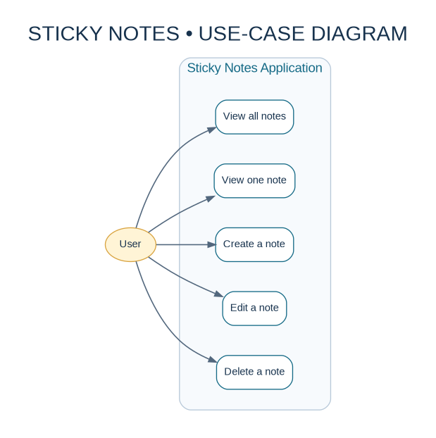
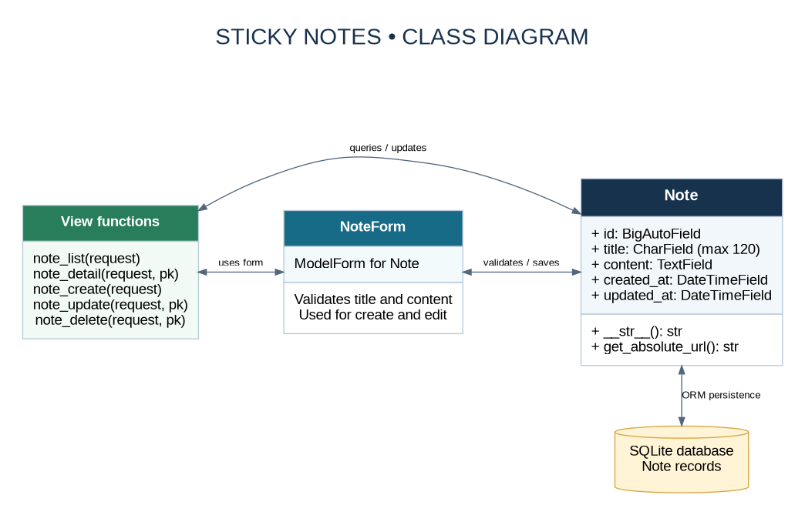
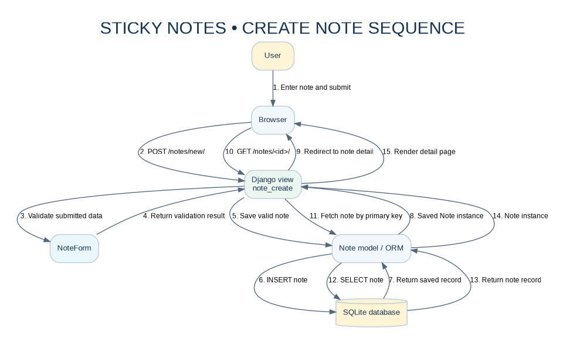

# Sticky Notes — Design Diagrams

This folder contains the editable Mermaid source files (`.mmd`), polished image exports (`.png` and `.svg`), and PDF versions of the project's three design diagrams.

## 1. Use-case diagram

Shows the actions available to a user: list notes, view a note, create, edit, and delete notes.

## 2. Class diagram

Shows the main Django components and their relationships: the `Note` model, `NoteForm`, view functions, and the SQLite database accessed through Django's ORM.

## 3. Sequence diagram

Shows the successful create-note workflow from form submission through validation and database persistence to the note detail page. The editable Mermaid source also includes the invalid-form path.

## Files

- `use_case_diagram.mmd`, `class_diagram.mmd`, `sequence_diagram.mmd` — editable Mermaid source.
- `images/*.png` — easy-to-view image exports, suitable for GitHub and document submissions.
- `images/*.svg` — scalable vector exports that remain sharp when zoomed.
- `*_diagram.pdf` — individual PDF exports.
- `sticky_notes_diagrams.pdf` — combined PDF containing all three diagrams.
