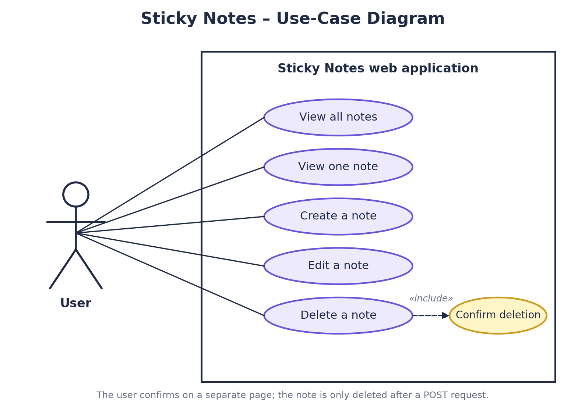
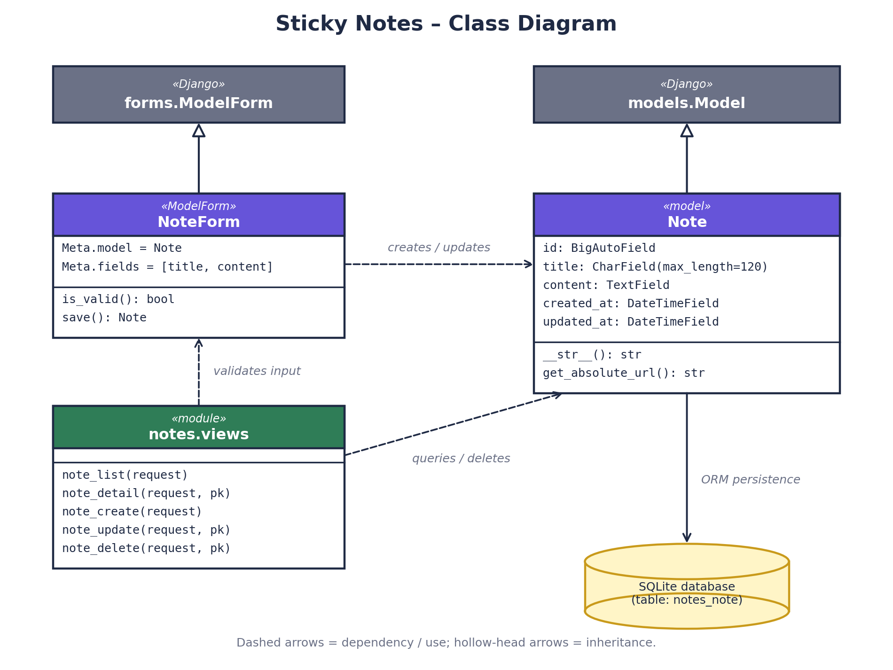
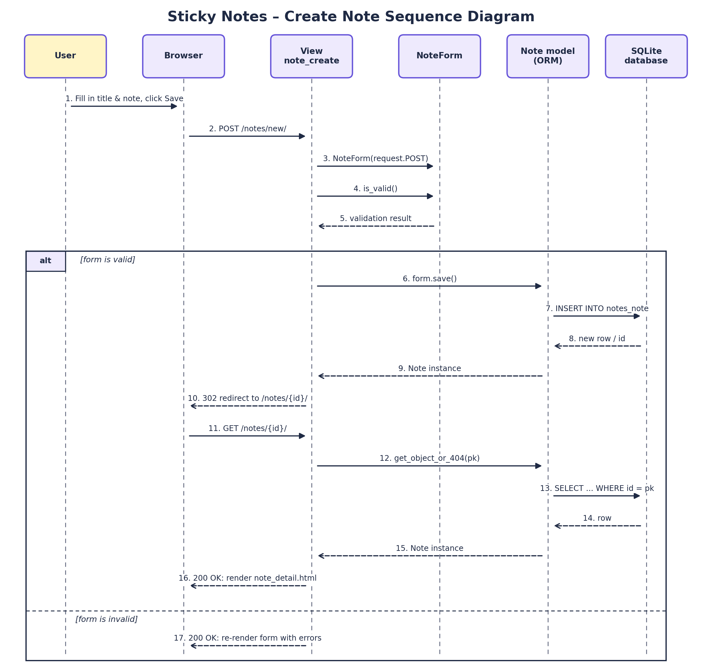

# Sticky Notes — Design Diagrams

This folder contains the three design diagrams for the project as images, PDFs and Markdown (this file).

| Diagram | PNG | SVG | PDF |
| --- | --- | --- | --- |
| Use-case | [PNG](images/use_case_diagram.png) | [SVG](images/use_case_diagram.svg) | [PDF](use_case_diagram.pdf) |
| Class | [PNG](images/class_diagram.png) | [SVG](images/class_diagram.svg) | [PDF](class_diagram.pdf) |
| Sequence | [PNG](images/sequence_diagram.png) | [SVG](images/sequence_diagram.svg) | [PDF](sequence_diagram.pdf) |

All three are also combined in one file: [sticky_notes_diagrams.pdf](sticky_notes_diagrams.pdf).

## 1. Use-case diagram

A user can list notes, view a single note, create, edit and delete notes. Deleting always includes a confirmation step.

## 2. Class diagram

`Note` extends Django's `models.Model` and is stored in SQLite through the ORM. `NoteForm` extends `forms.ModelForm` and creates or updates `Note` objects. The view functions in `notes/views.py` use `NoteForm` to validate input and query or delete `Note` records.

## 3. Sequence diagram

Shows the create-note workflow: the browser posts the form, the view validates it with `NoteForm`, the note is saved through the ORM, and the browser is redirected to the detail page. The `alt` frame shows the invalid-form path, where the form is shown again with errors.

## Editable sources

The `source/` folder holds the Mermaid (`.mmd`) versions of the diagrams. They are only editing sources; use the files above for viewing or marking.
